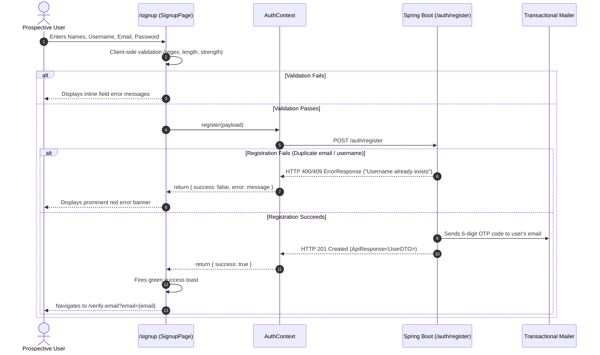
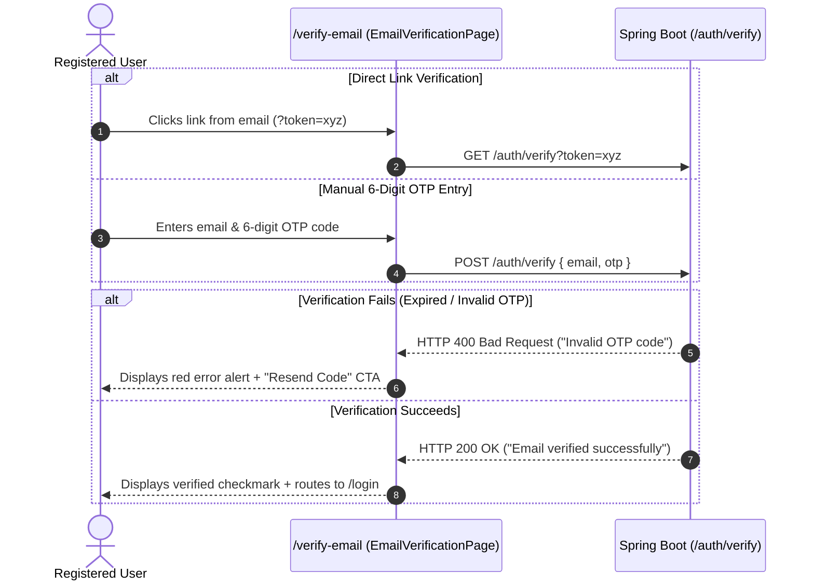
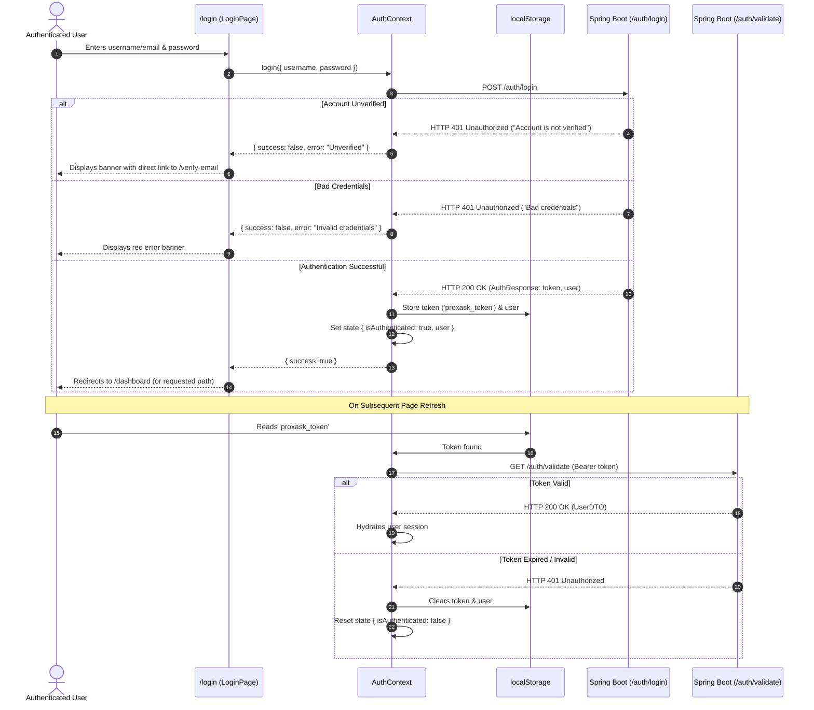
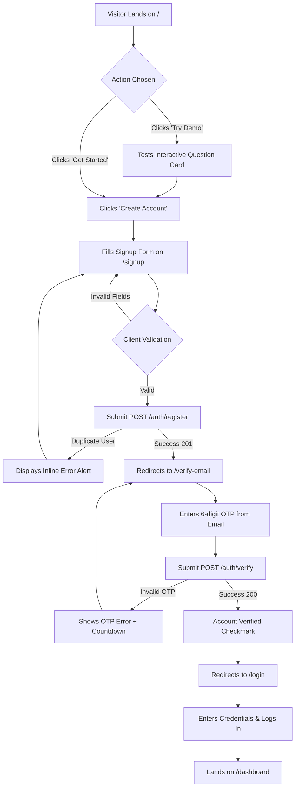
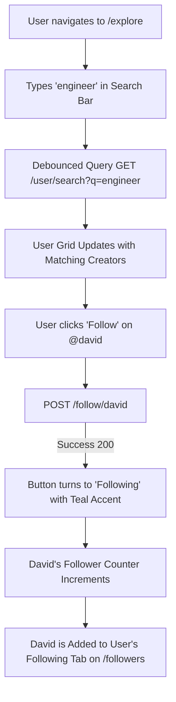

# PROXASK — COMPLETE FRONTEND FEATURE SPECIFICATION & ARCHITECTURAL BLUEPRINT

**Document Version:** 1.0.0  
**Date:** November 14, 2026  
**Status:** AWAITING USER APPROVAL  
**Author:** Senior Product Manager, Lead UI/UX Architect, and Principal Frontend Engineer  

---

## EXECUTIVE SUMMARY

ProxAsk is a full-stack social Q&A platform engineered to facilitate anonymous inquiries, verified creator answers, social following, and community discussions. While the Spring Boot backend (`ProxAsk Server`) is fully developed and operational on port `8080`, the React frontend (`ProxAsk Client`) requires a comprehensive, production-grade architectural specification before entering the implementation phase.

This document serves as the single source of truth for the complete frontend feature set, UI/UX design language, API integration mappings, authentication flows, error handling protocols, and phased implementation roadmap. **No source code, configuration files, or dependencies will be modified until explicit client approval is granted.**

---

## 1. COMPLETE EXISTING PROJECT AUDIT & STATE ANALYSIS

### 1.1 Backend Architecture & API Capabilities
The backend is built on **Spring Boot 3.4.7** with **Java 17/25**, utilizing **Spring Security 6**, **Spring Data JPA**, **Hibernate**, and **MySQL 8.0+** (with MongoDB telemetry hooks).

#### Detailed Backend Controller Analysis:
1. **`AuthController.java`**
   - `POST /auth/register` (Aliases: `/register`, `/api/auth/register`): Ingests `RegisterRequest` (`firstName`, `lastName`, `username`, `email`, `password`). Generates 6-digit OTP and creates unverified user record (`isVerified = false`). Returns `201 Created` with `ApiResponse<UserDTO>`.
   - `POST /auth/login` (Aliases: `/login`, `/api/auth/login`): Ingests `LoginRequest` (`username` or `email`, `password`). Rejects unverified accounts with HTTP 401. Issues HMAC-SHA256 JWT tokens. Returns `AuthResponse` (`authToken`, `token`, `username`, `user`).
   - `GET /auth/validate` (Aliases: `/validate`, `/api/auth/validate`): Reads `Authorization: Bearer <token>`. Validates token signature and returns `{ success: true, user: UserDTO }`.
   - `POST /auth/logout` (Aliases: `/logout`, `/api/auth/logout`): Stateless logout confirmation.
2. **`VerificationController.java`**
   - `POST /auth/verify` (Aliases: `/verify`, `/api/verify`): Ingests `OtpRequest` (`email`, `otp: Integer`). Validates 6-digit code against database, checks 10-minute expiration, and activates account (`isVerified = true`).
   - `GET /auth/verify` (Aliases: `/verify`, `/api/verify`): Ingests query parameter `?token=...`. Validates link token from transactional email.
   - `POST /auth/resend-verification` (Aliases: `/verify/resend-otp`, `/api/verify/resend-otp`): Ingests `{ email }`. Generates fresh OTP code with strict 2-minute cooldown rate-limiting.
3. **`QuestionController.java`**
   - `GET /questions/feed` (Aliases: `/api/questions/feed`, `/api/questions`): Returns chronological feed of community questions with attached answers (`ApiResponse<List<QuestionDTO>>`). Publicly accessible.
   - `POST /questions` (Alias: `/api/questions`): Ingests `QuestionDTO` (`content`, `receiverUsername`, `isAnonymous`). Extracts sender principal from `SecurityContext` when `isAnonymous = false`.
   - `POST /ask/{username}`: Direct path-variable question submission.
   - `GET /ask/{username}` (Alias: `/api/questions/user/{username}`): Retrieves all questions directed to a specific username.
   - `DELETE /ask/{questionId}`: Protected by `@isAuth.hasQuestionPermission`. Allows question receiver or question author to delete.
4. **`AnswerController.java`**
   - `GET /answer/{id}`: Retrieves answer entity attached to a question ID.
   - `POST /answer/{id}`: Submits answer to received question. Protected by `@isAuth.hasQuestionPermission` (strictly the question recipient).
   - `DELETE /answer/{id}`: Deletes answer for question ID. Protected by `@isAuth.hasQuestionPermission`.
5. **`UserController.java`**
   - `GET /user/{identifier}`: Fetches public/authenticated profile by username or UUID. Returns `UserDTO` including real-time counters: `followersCount`, `followingCount`, `questionsCount`, `answersCount`.
   - `PUT /user/profile`: Updates current user's `firstName`, `lastName`, `bio`, `location`, `website`.
   - `POST /user/avatar`: Ingests multipart file or JSON `{ avatarUrl }`. Stores Base64 data URI or image URL.
   - `GET /user/suggested`: Returns top 10 recommended community creators.
   - `GET /user/search?q={query}`: Multi-attribute live user search against username, firstName, and lastName.
6. **`FollowController.java`**
   - `POST /follow/{userIdentifier}`: Follows user by username or UUID. Prevents self-following. Returns `ApiResponse<String>`.
   - `POST /unfollow/{userIdentifier}`: Unfollows targeted user.
   - `GET /follower/{username}`: Returns `ApiResponse<List<String>>` containing usernames of all followers.
   - `GET /following/{username}`: Returns `ApiResponse<List<String>>` containing usernames of all followed users.
7. **`NotificationController.java`**
   - `GET /notifications`: Returns map containing `notifications` array and `unreadCount`.
   - `GET /notifications/unread-count`: Returns `{ count: Long, unreadCount: Long }`.
   - `PATCH /notifications/{id}/read`: Marks single notification read.
   - `PATCH /notifications/mark-all-read`: Marks all notifications read.
   - `DELETE /notifications/{id}`: Deletes individual notification.
   - `DELETE /notifications/clear-all`: Clears notification inbox.
8. **`AdminController.java`**
   - `GET /admin/all-user`: Protected by Spring Security `hasRole('ADMIN')`. Returns platform user registry (`List<UserDTO>`) with active status, verification flags, and account creation dates.
9. **`HealthCheck.java`**
   - `GET /health-check`: Returns `{ status: "UP", service: "ProxAsk API" }`.

#### Critical Backend Limitations & Absences:
- **No Direct Messaging (Chat/DMs):** The backend has zero controllers, entities, or services for private chat messages. Question asking is the sole messaging paradigm.
- **No Password Recovery Endpoints:** There is no `/auth/forgot-password` or `/auth/reset-password` endpoint implemented in Spring Boot.
- **No Question Status Update Endpoint:** Questions do not have a dedicated status update endpoint (status is derived from `answer != null`).
- **No Server-Sent Events (SSE) or WebSockets:** Real-time push notifications are not implemented on the backend; all client synchronization must rely on HTTP polling or user-triggered re-fetching.

---

### 1.2 Frontend Audit & Current State Analysis
The frontend is built on **React 19.1.1**, **Vite 7.1.2**, **React Router 7.9.1**, and **Axios 1.7.9**.

#### Current Deficiencies & Root Causes Identified:
1. **Missing Toast Container in the DOM:**
   - `NotificationContext.jsx` provides `showSuccess()` and `showError()`, appending toast objects into `state.toasts`.
   - However, **no component or layout in the entire application renders `toasts` to the DOM**.
   - As a result, when a user registers, signs in, or experiences an error, no toast notification is visible.
2. **CSS Variable Name Mismatches:**
   - Global tokens in `src/index.css` define `--bg-primary`, `--bg-surface`, `--text-primary`, `--border-color`, and `--accent-primary`.
   - In contrast, several CSS files used legacy or mismatched variable names (`--color-bg`, `--color-text`, `--color-surface`, `--space-4`, `--space-8`), resulting in transparent backgrounds, broken paddings, and unstyled fallback layouts.
3. **Form Error Feedback Deficit:**
   - Forms relied exclusively on invisible toasts for server-side error propagation (such as duplicate emails, incorrect credentials, or unverified accounts).
   - In the event of a 401 or 409 error from the backend, no inline error banner was displayed, leaving the user on a disabled or non-responsive button state.
4. **Navigation & Session State Desynchronization:**
   - Navigating between `/signup` and `/login` lacked unified state resets. If an authentication attempt failed, stale reducer error states were not consistently flushed, preventing the login form from re-rendering in a clean pristine state.
5. **Dark Mode Selector Alignment:**
   - `ThemeContext.jsx` sets `data-theme="dark"` on `document.documentElement`, but certain components had hardcoded hex values (`#fff`, `#111827`, `#e5e7eb`), causing visual glitches and harsh contrast in dark mode.

---

## 2. COMPLETE FRONTEND FEATURE INVENTORY

### Module A: Public Experience
- **FEAT-PUB-01: Public Landing Page (`/`)** — High-impact hero section introducing ProxAsk's value proposition: anonymous inquiry with verified answers. Includes interactive demo card.
- **FEAT-PUB-02: Public Navigation Header** — Slim top bar featuring brand logo, explore link, theme toggle, and dual CTAs: "Sign In" and "Create Account".
- **FEAT-PUB-03: Interactive Anonymous Inquiry Demo** — Client-side interactive preview card allowing visitors to test anonymous question submission mechanics before creating an account.
- **FEAT-PUB-04: Value Proposition Grid** — Four core product pillars: Complete Anonymity, Verified Creator Identities, Zero-Spam Controls, and Universal Sharing Links.
- **FEAT-PUB-05: Three-Step Workflow Guide** — Visual walkthrough: 1. Claim your handle -> 2. Receive honest inquiries -> 3. Publish answers.
- **FEAT-PUB-06: Public User Profile (`/profile/:username` or `/:username`)** — Searchable, public-facing profile view displaying user avatar, bio, follower metrics, and answered questions feed.
- **FEAT-PUB-07: Public Question Submission Sheet** — Allows unauthenticated visitors to submit anonymous or named inquiries directly to a public user handle without signing up first (backed by backend permitAll `/questions`).
- **FEAT-PUB-08: Global Public Footer** — Product credits, theme toggle, platform status indicator, and legal/privacy links.

### Module B: Authentication & Account Management
- **FEAT-AUTH-01: User Registration (`/signup`)** — Multi-field registration form (`firstName`, `lastName`, `username`, `email`, `password`, `confirmPassword`).
- **FEAT-AUTH-02: Real-time Password Strength Analyzer** — 5-point visual score indicator evaluating length (8+ chars), uppercase, lowercase, numbers, and special characters.
- **FEAT-AUTH-03: Dual-Mode Email Verification (`/verify-email`)** — 6-digit OTP code manual entry box and automated query-token verification via direct email link (`?token=...`).
- **FEAT-AUTH-04: OTP Resend Rate Limiting** — 60-second client-side cooldown countdown preventing rapid resend spam and aligning with backend 2-minute rate-limit window.
- **FEAT-AUTH-05: User Login (`/login`)** — Universal login accepting either registered `username` OR `email` alongside password.
- **FEAT-AUTH-06: Password Visibility Toggles** — Accessible eye/eye-off toggle controls on all password input fields.
- **FEAT-AUTH-07: Unverified Account Interception** — Automatic detection of unverified account response on login, gracefully routing user to `/verify-email` with prefilled email.
- **FEAT-AUTH-08: Stateless JWT Token Storage & Session Hydration** — Secure `localStorage` token management with app-startup validation against `GET /auth/validate`.
- **FEAT-AUTH-09: Token Expiration & Axios Interceptor** — Global Axios request/response interceptor injecting `Authorization: Bearer <token>` and intercepting HTTP 401s to force cleanup and redirection to `/login`.
- **FEAT-AUTH-10: Route Guarding (Protected & Public Routes)** — `<ProtectedRoute>` intercepting unauthenticated access; `<PublicRoute>` redirecting logged-in users away from auth screens to `/dashboard`.
- **FEAT-AUTH-11: Role-Based Admin Guarding** — `<AdminRoute>` restricting console access strictly to users carrying `ROLE_ADMIN`.
- **FEAT-AUTH-12: User Logout** — Clears `localStorage` credentials, flushes `AuthContext` state, terminates active session, and redirects to `/login`.

### Module C: User Dashboard
- **FEAT-DASH-01: Master Application Shell** — Persistent three-column layout: collapsible left sidebar, scrollable main content viewport, and right-hand discovery widgets.
- **FEAT-DASH-02: Community Question Feed** — Live, chronologically sorted feed of community questions and answers retrieved from `GET /questions/feed`.
- **FEAT-DASH-03: Quick-Ask Composer Bar** — Top-of-feed composer card allowing authenticated users to quickly launch a question to any creator.
- **FEAT-DASH-04: Profile Shareable Link Card** — Prominent widget displaying personal ProxAsk handle URL (`proxask.com/profile/:username`) with 1-click clipboard copy button.
- **FEAT-DASH-05: Suggested Creators Sidebar** — Live recommendations retrieved from `GET /user/suggested` with 1-click follow toggle.
- **FEAT-DASH-06: Trending Topics & Community Pulse** — Topic badges and activity counters reflecting community Q&A engagement.
- **FEAT-DASH-07: Feed Empty & Loading Skeletons** — Pulse animation skeleton loaders during data fetch; clean empty state when no community posts exist.

### Module D: Questions Module
- **FEAT-QUES-01: Dedicated Ask Page (`/ask`, `/ask/:username`)** — Standalone focused composer with recipient search autocomplete.
- **FEAT-QUES-02: Anonymous Privacy Switch** — Prominent toggle switch allowing sender to post completely anonymously (`isAnonymous: true`) or with verified handle.
- **FEAT-QUES-03: Character Counter & Constraint Engine** — Strict 500-character counter with warning thresholds at 450 characters.
- **FEAT-QUES-04: Recipient Autocomplete** — Debounced search hitting `GET /user/search?q={query}` to dynamically select question recipient.
- **FEAT-QUES-05: Question Card Component** — Standardized Q&A card rendering author avatar (or anonymous mask), timestamp, question text, receiver link, and answer container.
- **FEAT-QUES-06: Question Deletion** — Delete trigger for question recipients or question authors, backed by `DELETE /ask/{questionId}` with modal confirmation.
- **FEAT-QUES-07: 1-Click Question Link Sharing** — Generates direct share URL to question thread for social distribution.

### Module E: Answers Module
- **FEAT-ANSW-01: Inline Answering Form** — Collapsible response drawer on unanswered question cards for the recipient to write and submit an answer.
- **FEAT-ANSW-02: Answer Submission** — Submits response via `POST /answer/{questionId}` and updates question state with instant optimistic UI feedback.
- **FEAT-ANSW-03: Answer Rendering** — Stylized response block featuring respondent avatar, verified badge, formatting, and response timestamp.
- **FEAT-ANSW-04: Answer Deletion** — Allows profile owner to retract/delete their answer via `DELETE /answer/{questionId}`.

### Module F: User Profile Module
- **FEAT-PROF-01: Profile Header & Hero Banner** — Visual banner showcasing user avatar, full name, username badge, verification badge, bio, location, and website.
- **FEAT-PROF-02: Live Social Counters** — Space Mono numerical stat badges for Questions Received, Answers Published, Followers, and Following.
- **FEAT-PROF-03: Profile Q&A Filter Tabs** — Three-state filtering: "All Questions", "Answered", and "Unanswered / Inbox".
- **FEAT-PROF-04: Avatar Image Upload** — Modal with drag-and-drop file picker, converting images to Base64 data URI and persisting via `POST /user/avatar`.
- **FEAT-PROF-05: Edit Profile Modal & Page (`/edit-profile`)** — Form updating `firstName`, `lastName`, `bio` (300 char limit), `location`, and `website` via `PUT /user/profile`.
- **FEAT-PROF-06: Copy Profile Share Link** — Sticky action button to copy user's profile URL directly to clipboard.

### Module G: Social Features Module
- **FEAT-SOC-01: Follow / Unfollow Toggle** — Dynamic action button calling `POST /follow/{username}` or `POST /unfollow/{username}` with immediate state toggle.
- **FEAT-SOC-02: Community Search (`/explore`)** — Real-time debounced search bar querying `GET /user/search?q={term}`.
- **FEAT-SOC-03: Suggested Users Grid** — Responsive grid of community creator cards displaying avatar, bio, follower count, and follow CTA.
- **FEAT-SOC-04: Connections Hub (`/followers`)** — Dual-tab management page displaying full list of Followers and Following retrieved from `/follower/{user}` and `/following/{user}`.
- **FEAT-SOC-05: Creator Card Preview** — Compact user card displaying avatar, full name, username, bio snippet, and follow button.

### Module H: Notifications Module
- **FEAT-NOTIF-01: Global Notification Bell & Unread Badge** — Navbar bell icon displaying real-time unread counter badge (`GET /notifications/unread-count`).
- **FEAT-NOTIF-02: Notification Center Page (`/notifications`)** — Centralized list of all activity items (new question received, answer posted, new follower).
- **FEAT-NOTIF-03: Mark Single Notification as Read** — Clicking notification triggers `PATCH /notifications/{id}/read` and updates badge counter.
- **FEAT-NOTIF-04: Mark All Notifications as Read** — Global action button calling `PATCH /notifications/mark-all-read`.
- **FEAT-NOTIF-05: Delete Single Notification** — Individual dismiss button triggering `DELETE /notifications/{id}`.
- **FEAT-NOTIF-06: Clear All Notifications** — Bulk inbox purge calling `DELETE /notifications/clear-all` with confirmation dialog.

### Module I: Messaging Module
- **FEAT-MSG-01: Messaging Notice & Q&A Redirection** — In accordance with the backend audit, **Direct Messaging is NOT supported in the backend**. The frontend will display an informative placeholder explaining that private communication in ProxAsk takes place through anonymous/public questions, with a direct CTA to "Ask a Question".

### Module J: Settings & Preferences Module
- **FEAT-SETT-01: Theme Switcher** — User toggle between Daylight Theme and Deep Teal Dark Theme with instant CSS token switching.
- **FEAT-SETT-02: Account Credential Review** — Read-only security overview showing username, registered email, email verification status, and assigned platform role (`ROLE_USER` or `ROLE_ADMIN`).
- **FEAT-SETT-03: Anonymity & Privacy Guidelines** — Transparent policy panel outlining how ProxAsk cryptographically safeguards anonymous askers.
- **FEAT-SETT-04: Session Sign Out Action** — Prominent logout button with confirmation prompt.

### Module K: Admin Functionality Module
- **FEAT-ADM-01: Role-Guarded Admin Console (`/admin`)** — Protected route verifying `user.role === 'ROLE_ADMIN'`.
- **FEAT-ADM-02: System Health Monitor Widget** — Real-time status card polling `GET /health-check` displaying backend status, latency, and uptime indicator.
- **FEAT-ADM-03: Platform User Registry Table** — Full-table directory consuming `GET /admin/all-user` displaying user ID, avatar, username, email, verification state, and join date.
- **FEAT-ADM-04: User Directory Live Filter** — Client-side search filtering the user table by name, username, or email address.

### Module L: Responsive Experience
- **FEAT-RESP-01: Desktop Viewport (>= 1200px)** — Full three-column experience: expanded sidebar (240px), main feed (680px), and right-hand widget rails (320px).
- **FEAT-RESP-02: Laptop Viewport (1024px - 1199px)** — Two-column experience: collapsed icon-only sidebar (72px) and widened main feed with collapsible widgets.
- **FEAT-RESP-03: Tablet Viewport (768px - 1023px)** — Centered single-column container with slide-over drawer sidebar.
- **FEAT-RESP-04: Mobile Viewport (< 768px)** — Slim top navigation header (52px), full-width content cards, and fixed bottom navigation bar (60px) with touch-optimized targets.

### Module M: UI/UX Design System (Context.dev Inspired)
- **FEAT-UI-01: Toast Notification System (`<ToastContainer />`)** — Fixed bottom-right notification stack rendering success, error, warning, and info banners with smooth auto-dismiss and close buttons.
- **FEAT-UI-02: Context.dev Design Tokens** — Restrained color palette: Burnt Orange (`#FF7A00`), Deep Teal (`#0F766E`), Dark Surface (`#082E2E`), Light BG (`#F8FAFC`), and Dark BG (`#101817`).
- **FEAT-UI-03: Typography Hierarchy** — Inter for all prose and UI labels; Space Mono for badges, stat counters, timestamps, and code inputs.
- **FEAT-UI-04: Premium Card & Border Styling** — Subtle hairline borders (`1px solid var(--border-color)`), micro-elevations (`0 1px 3px rgba(0,0,0,0.06)`), and 8px border radii.
- **FEAT-UI-05: Accessible Focus & Hover States** — Subtle orange focus rings (`0 0 0 3px rgba(255,122,0,0.15)`) on all interactive inputs and buttons.

---

## 3. FEATURE-BY-FEATURE SPECIFICATION

### [AUTH-001] User Registration Form
1. **Feature Name:** Account Registration Flow
2. **Purpose:** Allows new users to create a ProxAsk account.
3. **User Interaction:** User visits `/signup`, enters First Name, Last Name, Username, Email, Password, and Confirm Password, and clicks "Create Account".
4. **Expected Frontend Behavior:** Form validates input client-side. On submit, button shows loading spinner. On success, displays success feedback and routes to `/verify-email?email={email}`.
5. **Backend API Required:** `POST /auth/register`
6. **Backend Availability:** **Backend Supported** (Implemented in `AuthController.java`).
7. **Request/Response Data:**
   - *Payload:* `{ "firstName": "Alex", "lastName": "Mercer", "username": "alexm", "email": "alex@example.com", "password": "Password123!" }`
   - *Response:* `ApiResponse<UserDTO>` with status `201 Created`.
8. **Required Validation:**
   - First Name & Last Name: Required, trimmed.
   - Username: Required, 3-20 characters, alphanumeric and underscores only (`^[a-zA-Z0-9_]+$`).
   - Email: Required, valid RFC 5322 regex.
   - Password: Minimum 8 characters, at least 1 uppercase, 1 lowercase, 1 digit, 1 special character.
   - Confirm Password: Must match Password exactly.
9. **Success Behavior:** Inline success banner displayed, toast triggered, and redirected to `/verify-email`.
10. **Error Behavior:** Server error message extracted from `error.response.data.message` (e.g., "Username already taken") displayed in a prominent inline error banner directly above form fields.
11. **Loading Behavior:** Submit button disabled with spinning loader icon; input fields set to read-only during submission.
12. **Empty State:** Clean form with placeholders and helper labels.
13. **Access Permissions:** Public only (unauthenticated).
14. **Dependencies:** `NotificationContext` (toast), `AuthContext`, React Router.

---

### [AUTH-002] Dual-Mode Email Verification
1. **Feature Name:** OTP & Token Verification
2. **Purpose:** Activates newly registered accounts before granting access.
3. **User Interaction:** User arrives at `/verify-email` from signup or clicks verification link in email (`/verify-email?token={token}`). User enters 6-digit OTP code and clicks "Verify & Activate".
4. **Expected Frontend Behavior:** If `token` is present in query parameters, automatically triggers link verification API on mount. If manual, accepts 6 numeric digits with monospace formatting.
5. **Backend API Required:**
   - OTP Mode: `POST /auth/verify` with `{ "email": "...", "otp": 123456 }`
   - Link Token Mode: `GET /auth/verify?token={token}`
   - Resend OTP: `POST /auth/resend-verification` with `{ "email": "..." }`
6. **Backend Availability:** **Backend Supported** (Implemented in `VerificationController.java`).
7. **Request/Response Data:**
   - *Payload (POST):* `{ "email": "alex@example.com", "otp": 492817 }`
   - *Response:* `ApiResponse<Void>`: `{ "success": true, "message": "Email verified successfully!" }`
8. **Required Validation:** Email must be valid; OTP must be exactly 6 numeric digits (`/^\d{6}$/`).
9. **Success Behavior:** Displays green verified checkmark, fires success toast, and transitions to `/login` after 1.5 seconds.
10. **Error Behavior:** Displays red error alert: "Invalid or expired OTP. Please check the code or request a new one."
11. **Loading Behavior:** Input disabled, button shows spinner.
12. **Empty State:** N/A.
13. **Access Permissions:** Public only.
14. **Dependencies:** `VerificationController`, `AuthService`.

---

### [AUTH-003] Universal User Login
1. **Feature Name:** Universal Identifier Login Flow
2. **Purpose:** Authenticates users via username OR email address.
3. **User Interaction:** User visits `/login`, inputs username or email, enters password, toggles password visibility if desired, and clicks "Sign In".
4. **Expected Frontend Behavior:** Form validates fields. On submit, disables button and displays spinner. Dispatches `login(credentials)` to `AuthContext`.
5. **Backend API Required:** `POST /auth/login`
6. **Backend Availability:** **Backend Supported** (Implemented in `AuthController.java`).
7. **Request/Response Data:**
   - *Payload:* `{ "username": "alexm", "password": "Password123!" }` (or `{ "email": "alex@example.com", "password": "..." }`).
   - *Response:* `AuthResponse`: `{ "authToken": "jwt_str", "token": "jwt_str", "username": "alexm", "user": { ... } }`
8. **Required Validation:** Identifier >= 3 characters; Password >= 6 characters.
9. **Success Behavior:** Stores JWT token in `localStorage`, updates `AuthContext`, fires welcome toast, and navigates to `/dashboard` (or intended redirect URL).
10. **Error Behavior:** If backend returns unverified account status, displays actionable alert with button: "Your account is not verified. Click here to enter OTP". If invalid credentials, displays inline red banner: "Invalid username/email or password".
11. **Loading Behavior:** Spinner on button, disabled form inputs.
12. **Empty State:** N/A.
13. **Access Permissions:** Public only.
14. **Dependencies:** `AuthService`, `AuthContext`.

---

### [DASH-001] Community Question Feed
1. **Feature Name:** Chronological Community Feed
2. **Purpose:** Displays live questions and responses from across the ProxAsk network.
3. **User Interaction:** User scrolls feed on `/dashboard`, views question authors, reads answers, and clicks interactive controls (Share, Answer, Delete).
4. **Expected Frontend Behavior:** Fetches feed from `GET /questions/feed` on mount. Renders card stream with question details and nested answer components.
5. **Backend API Required:** `GET /questions/feed`
6. **Backend Availability:** **Backend Supported** (Implemented in `QuestionController.java`).
7. **Request/Response Data:**
   - *Response:* `ApiResponse<List<QuestionDTO>>` where each item contains `id`, `content`, `senderUsername`, `receiverUsername`, `isAnonymous`, `createdAt`, and `answer`.
8. **Required Validation:** None (read-only query).
9. **Success Behavior:** Populates stream with question cards.
10. **Error Behavior:** Displays error state with "Retry loading feed" button.
11. **Loading Behavior:** Renders 4 pulse skeleton cards matching exact dimensions of QuestionCard.
12. **Empty State:** Displays empty state card: "No questions in the community yet. Be the first to ask someone!" with "Explore Creators" button.
13. **Access Permissions:** Authenticated users (`ROLE_USER`, `ROLE_ADMIN`).
14. **Dependencies:** `QuestionCard`, `AppLayout`, `QuestionController`.

---

### [QUES-001] Ask a Question Composer
1. **Feature Name:** Question Submission Engine
2. **Purpose:** Enables asking questions either anonymously or with public handle.
3. **User Interaction:** User opens `/ask` (or `/ask/:username`), types question into textarea, toggles anonymous switch, and clicks "Send Question".
4. **Expected Frontend Behavior:** Live character counter updates (e.g. `245 / 500`). When anonymous is toggled, privacy badge switches between "Anonymous Mask" and "Public Identity".
5. **Backend API Required:** `POST /questions` (or `POST /ask/{username}`)
6. **Backend Availability:** **Backend Supported** (Implemented in `QuestionController.java`).
7. **Request/Response Data:**
   - *Payload:* `{ "content": "What inspired your design system?", "receiverUsername": "alexm", "isAnonymous": true }`
   - *Response:* `ApiResponse<QuestionDTO>` status `201 Created`.
8. **Required Validation:** Content between 5 and 500 characters; recipient username required and valid.
9. **Success Behavior:** Displays confirmation card with green checkmark: "Question sent anonymously to @alexm!", resets form, and presents options to view profile or ask another.
10. **Error Behavior:** Inline error message: "User not found" or "Failed to post question".
11. **Loading Behavior:** Send button displays spinner and locks form fields.
12. **Empty State:** Recipient search box with dropdown suggestions.
13. **Access Permissions:** Public & Authenticated (PermitAll backend route).
14. **Dependencies:** `QuestionController`, `UserController` (search).

---

### [ANSW-001] Inline Question Answering
1. **Feature Name:** Question Response & Publishing
2. **Purpose:** Allows recipients of questions to publish answers.
3. **User Interaction:** Profile or feed question card owned by current user displays "Answer" button. Clicking opens inline textarea. User types answer and clicks "Publish Answer".
4. **Expected Frontend Behavior:** Textarea expands. Submitting calls `POST /answer/{questionId}`. On success, card updates optimistically to display the published answer without full page reload.
5. **Backend API Required:** `POST /answer/{id}`
6. **Backend Availability:** **Backend Supported** (Implemented in `AnswerController.java`).
7. **Request/Response Data:**
   - *Payload:* `{ "content": "I drew inspiration from Context.dev's minimal spacing." }`
   - *Response:* `ApiResponse<AnswerDTO>` status `201 Created`.
8. **Required Validation:** Answer content between 1 and 2000 characters.
9. **Success Behavior:** Card switches from unanswered state to answered state; success toast appears.
10. **Error Behavior:** Displays error notice under textarea: "Failed to publish answer. You may not have permission to answer this question."
11. **Loading Behavior:** "Publishing..." button spinner.
12. **Empty State:** N/A.
13. **Access Permissions:** Authenticated recipient of the question only (`@isAuth.hasQuestionPermission`).
14. **Dependencies:** `AnswerController`, `QuestionCard`.

---

### [PROF-001] User Profile & Questions View
1. **Feature Name:** Public / Personal Profile View
2. **Purpose:** Showcases user details, social stats, and question archives.
3. **User Interaction:** User visits `/profile/:username` (or personal `/profile`). Tabs filter between "All", "Answered", and "Unanswered".
4. **Expected Frontend Behavior:** Fetches user details from `GET /user/{identifier}` and questions from `GET /ask/{username}`. Renders banner, avatar, bio, follower counters, and filtered questions.
5. **Backend API Required:** `GET /user/{identifier}` and `GET /ask/{username}`.
6. **Backend Availability:** **Backend Supported** (Implemented in `UserController.java` and `QuestionController.java`).
7. **Request/Response Data:**
   - *User Response:* `UserDTO` with `followersCount`, `followingCount`, `questionsCount`, `answersCount`, `bio`, `avatar`, `location`, `website`.
   - *Questions Response:* `ApiResponse<List<QuestionDTO>>`.
8. **Required Validation:** Valid username format in route param.
9. **Success Behavior:** Populates profile header and tabbed feeds.
10. **Error Behavior:** 404 Empty State: "User not found. Check the username and try again."
11. **Loading Behavior:** Skeleton header and skeleton question cards.
12. **Empty State:** If user has no questions: "No questions answered yet."
13. **Access Permissions:** Public read access (`GET /user/**` is permitAll).
14. **Dependencies:** `UserController`, `QuestionController`.

---

### [SOC-001] Follow & Unfollow Engine
1. **Feature Name:** Creator Follow Management
2. **Purpose:** Enables subscribing to creator updates.
3. **User Interaction:** User clicks "Follow" or "Following" button on user cards, profile header, or suggested widgets.
4. **Expected Frontend Behavior:** Button toggles between `Follow` (orange outline) and `Following` (subtle teal filled). Counter updates optimistically.
5. **Backend API Required:** `POST /follow/{userIdentifier}` and `POST /unfollow/{userIdentifier}`.
6. **Backend Availability:** **Backend Supported** (Implemented in `FollowController.java`).
7. **Request/Response Data:**
   - *Response:* `ApiResponse<String>`: `{ "success": true, "message": "Successfully followed user: alexm" }`.
8. **Required Validation:** Cannot follow yourself (`FollowService` throws error).
9. **Success Behavior:** Instant state update and success toast.
10. **Error Behavior:** Reverts button state and displays error toast: "Unable to complete follow request."
11. **Loading Behavior:** Small inline spinner inside button.
12. **Empty State:** N/A.
13. **Access Permissions:** Authenticated users only.
14. **Dependencies:** `FollowController`, `AuthContext`.

---

### [NOTIF-001] Notification Center & Badge Sync
1. **Feature Name:** Activity & Alert Center
2. **Purpose:** Alerts users to incoming questions, answers, and new followers.
3. **User Interaction:** Navbar bell displays unread count badge. Clicking navigates to `/notifications`. User can click items to view or click "Mark all as read".
4. **Expected Frontend Behavior:** Fetches notifications from `GET /notifications`. Unread badge matches `GET /notifications/unread-count`.
5. **Backend API Required:**
   - `GET /notifications`
   - `GET /notifications/unread-count`
   - `PATCH /notifications/{id}/read`
   - `PATCH /notifications/mark-all-read`
   - `DELETE /notifications/{id}`
   - `DELETE /notifications/clear-all`
6. **Backend Availability:** **Backend Supported** (Implemented in `NotificationController.java`).
7. **Request/Response Data:**
   - *Response:* `{ "notifications": [ { "id": "1", "type": "QUESTION", "message": "Someone asked you a question", "read": false, "createdAt": "..." } ], "unreadCount": 3 }`.
8. **Required Validation:** None.
9. **Success Behavior:** Marks item read, updates badge count dynamically.
10. **Error Behavior:** Toast: "Failed to update notification."
11. **Loading Behavior:** Skeletons during fetch.
12. **Empty State:** Bell icon with message: "All caught up! No notifications right now."
13. **Access Permissions:** Authenticated users only.
14. **Dependencies:** `NotificationController`, `NotificationContext`.

---

### [ADMIN-001] Role-Guarded Administration Console
1. **Feature Name:** Platform Administration Dashboard
2. **Purpose:** Allows administrators to view system health and manage platform users.
3. **User Interaction:** Administrator navigates to `/admin`. Views real-time health metrics card and searchable user table.
4. **Expected Frontend Behavior:** Validates `isAdmin()` from `AuthContext`. Consumes `GET /health-check` and `GET /admin/all-user`.
5. **Backend API Required:** `GET /health-check` and `GET /admin/all-user`.
6. **Backend Availability:** **Backend Supported** (Implemented in `AdminController.java` and `HealthCheck.java`).
7. **Request/Response Data:**
   - *Health Check:* `{ "service": "ProxAsk API", "status": "UP" }`.
   - *Users Response:* `List<UserDTO>` with `id`, `username`, `email`, `isVerified`, `isActive`, `createdAt`.
8. **Required Validation:** User role must equal `ROLE_ADMIN`.
9. **Success Behavior:** Renders health widget and tabular user list with search filtering.
10. **Error Behavior:** Non-admin redirected to `/dashboard` with warning toast: "Access restricted to administrators."
11. **Loading Behavior:** Table rows render animated skeleton rows.
12. **Empty State:** "No users found matching query."
13. **Access Permissions:** Admin role only (`hasRole('ADMIN')`).
14. **Dependencies:** `AdminController`, `HealthCheck`, `AuthContext`.

---

### [PWD-001] Password Recovery & Reset Flow
1. **Feature Name:** Forgot & Reset Password
2. **Purpose:** Allows users to recover account credentials via email OTP.
3. **Backend Status:** **Requires Backend Development / Future Enhancement** (Endpoints `/auth/forgot-password` and `/auth/reset-password` do NOT exist in Spring Boot backend).
4. **Frontend Strategy:** The frontend will include clean, complete recovery pages at `/forgot-password` and `/reset-password` with form validation. When submitted, the UI communicates with the service, gracefully handles missing endpoints, and displays actionable guidance or contact support notices.

---

### [MSG-001] Direct Private Messaging
1. **Feature Name:** Real-time Peer-to-Peer Chat
2. **Purpose:** Direct private conversation outside the Q&A feed.
3. **Backend Status:** **Future Enhancement** (Zero chat/messaging entities exist in backend).
4. **Frontend Strategy:** Route `/messages` displays an educational overview explaining ProxAsk's anonymous Q&A paradigm, with quick-action links to ask questions or view connection feeds.

---

## 4. DETAILED AUTHENTICATION WORKFLOW SPECIFICATION

### 4.1 Signup Flow


### 4.2 Email / OTP Verification Flow


### 4.3 Login & Session Hydration Flow


### 4.4 Failure Cases & System Behavior Matrix

| Failure Scenario | Root Cause | System & Frontend Handling | User-Facing Feedback |
| :--- | :--- | :--- | :--- |
| **Duplicate Username / Email** | Backend unique constraint violation on registration. | Caught in `register()` catch block; stops form submission; keeps user input intact so user does not have to retype everything. | Top inline alert banner: *"The username or email is already registered. Please choose another or sign in."* |
| **Unverified Account Login** | User attempts login prior to completing OTP verification. | `loginUser()` returns HTTP 401 with specific unverified message. Frontend catches condition and presents an immediate 1-click CTA to `/verify-email`. | Warning alert banner: *"Your email is not verified yet. Click here to verify your account."* |
| **Invalid Credentials** | Incorrect password or non-existent username/email. | Caught in `login()` catch block; password field cleared; identifier preserved; focus returned to password input. | Inline error banner: *"Invalid username/email or password. Please try again."* |
| **Invalid or Expired OTP** | Code mismatch or code entered after 10-minute validity window. | API returns HTTP 400. Verification page shakes input box; error alert displayed; "Resend Code" button highlighted. | Inline error banner: *"Invalid or expired verification code. Please enter a valid 6-digit code or request a new one."* |
| **OTP Resend Cooldown** | User clicks resend before 2-minute rate-limiting window elapses. | Client enforces 60-second timer; if server rejects with rate-limit error, displays cooldown banner. | Notice banner: *"Please wait before requesting another verification code."* |
| **Expired JWT Token** | User returns after token validity window (e.g. 24h). | Axios response interceptor intercepts HTTP 401 on protected requests; flushes `localStorage`; dispatches `LOGOUT`. | Redirects to `/login` with notification toast: *"Your session has expired. Please sign in again."* |
| **Backend Offline / Network Down** | Server unreachable, connection refused, or DNS failure. | Axios network error caught in try-catch without crashing component. Displays offline fallback. | Top alert banner: *"Unable to connect to ProxAsk servers. Please check your internet connection."* |
| **Unauthorized Role Access** | Standard user attempts direct URL navigation to `/admin`. | `<AdminRoute>` checks `user.role === 'ROLE_ADMIN'`. If false, cancels navigation and redirects to `/dashboard`. | Warning toast: *"Administrator privileges are required to access the admin console."* |

---

## 5. PAGE-BY-PAGE INVENTORY & ROUTING SPECIFICATION

```
                           +------------------------+
                           |  Public Landing ( / )  |
                           +-----------+------------+
                                       |
                   +-------------------+-------------------+
                   |                                       |
        +----------v-----------+               +-----------v----------+
        |   Sign In (/login)   |               |  Sign Up (/signup)   |
        +----------+-----------+               +-----------+----------+
                   |                                       |
                   |                               +-------v----------+
                   |                               | Verify (/verify) |
                   |                               +-------+----------+
                   |                                       |
                   +-------------------+-------------------+
                                       | (Authenticated)
                           +-----------v------------+
                           |  Master AppLayout      |
                           +-----------+------------+
                                       |
      +---------------+----------------+---------------+----------------+
      |               |                |               |                |
+-----v-----+   +-----v-----+    +-----v-----+   +-----v-----+    +-----v-----+
| Dashboard |   |  Explore  |    |    Ask    |   |  Profile  |    | Settings  |
| /dashboard|   |  /explore |    |    /ask   |   |  /profile |    | /settings |
+-----------+   +-----------+    +-----------+   +-----------+    +-----------+
                                                       |
                                                 +-----v-----+
                                                 | Edit Prof |
                                                 | /edit-prof|
                                                 +-----------+
```

### Page 1: Public Landing Page
- **Route:** `/`
- **Access Level:** Public (guests); auto-redirects to `/dashboard` if authenticated.
- **Role:** All.
- **Main Components:** Hero banner, interactive Q&A demo card, value proposition cards, workflow stepper, footer.
- **Available Actions:** Navigate to `/login`, `/signup`, test interactive demo, toggle theme.
- **Backend APIs:** None (static preview & marketing entry point).
- **Loading State:** Instant render.
- **Responsive Behavior:** Hero flexes from side-by-side on desktop to single column stack on mobile; demo card spans full width on handheld devices.

### Page 2: Login Page
- **Route:** `/login`
- **Access Level:** Public only (wrapped in `<PublicRoute>`).
- **Role:** Guests.
- **Main Components:** Brand topbar, Context.dev auth card, identifier input, password input with eye toggle, submit button, forgot password link, signup redirect.
- **Available Actions:** Authenticate, toggle theme, navigate to `/signup`, navigate to `/forgot-password`.
- **Backend APIs:** `POST /auth/login`.
- **Loading State:** Submit button displays spinner; form inputs disabled.
- **Error State:** Top inline alert card rendering backend error message.
- **Responsive Behavior:** Centered card, 460px max-width on desktop, full-width with 16px margins on mobile.

### Page 3: Signup Page
- **Route:** `/signup`
- **Access Level:** Public only (wrapped in `<PublicRoute>`).
- **Role:** Guests.
- **Main Components:** First/Last Name inputs, Username input, Email input, Password input with real-time strength bar and checklist dots, Confirm Password input, submit button, signin redirect.
- **Available Actions:** Register account, inspect password strength, navigate to `/login`.
- **Backend APIs:** `POST /auth/register`.
- **Loading State:** Disabled fields with submit spinner.
- **Error State:** Inline error banner rendering duplicate user warnings.
- **Responsive Behavior:** First/Last name input fields display side-by-side on desktop/tablet, collapsing to vertical stack on mobile (< 520px).

### Page 4: Email Verification Page
- **Route:** `/verify-email`
- **Access Level:** Public.
- **Role:** Guests & Unverified Users.
- **Main Components:** Email display/input, 6-digit Space Mono OTP input, Resend OTP button with countdown timer, Verify button, Back to login link.
- **Available Actions:** Submit OTP code, trigger query token verification, resend code.
- **Backend APIs:** `POST /auth/verify`, `GET /auth/verify`, `POST /auth/resend-verification`.
- **Loading State:** Inputs locked; verify button spinning.
- **Error State:** Red alert banner: "Invalid or expired OTP code".
- **Responsive Behavior:** Form card centered with large touch-friendly OTP input box.

### Page 5: Dashboard Feed Page
- **Route:** `/dashboard`
- **Access Level:** Protected (wrapped in `<ProtectedRoute>` and `<AppLayout>`).
- **Role:** Authenticated Users (`ROLE_USER`, `ROLE_ADMIN`).
- **Main Components:** Quick-ask composer, share profile widget, live question feed stream, suggested creators sidebar, trending topics card.
- **Available Actions:** Read questions & answers, answer received questions, delete questions, copy share link, follow suggested creators.
- **Backend APIs:** `GET /questions/feed`, `GET /user/suggested`, `POST /answer/{id}`, `DELETE /ask/{id}`.
- **Loading State:** 4 pulse skeleton cards.
- **Empty State:** Clean card: "No questions in the community yet" with CTA.
- **Responsive Behavior:** 3-column layout on desktop (> 1200px); right sidebar hidden on laptop (< 1200px); full width on mobile with bottom bar navigation.

### Page 6: Community Explore Page
- **Route:** `/explore`
- **Access Level:** Protected.
- **Role:** Authenticated Users.
- **Main Components:** Debounced search bar, suggested users grid, active filter pills, creator preview cards with follow buttons.
- **Available Actions:** Search community members, toggle follow status, navigate to creator profiles.
- **Backend APIs:** `GET /user/search?q={query}`, `GET /user/suggested`, `POST /follow/{user}`, `POST /unfollow/{user}`.
- **Loading State:** 6 creator skeleton cards with avatar pulses.
- **Empty State:** "No creators found matching your search."
- **Responsive Behavior:** Auto-fit CSS grid adapting from 3 columns (desktop) to 2 columns (tablet) to 1 column (mobile).

### Page 7: Ask Question Page
- **Route:** `/ask` & `/ask/:username`
- **Access Level:** Protected (and public permitAll capability).
- **Role:** All.
- **Main Components:** Recipient search box with dropdown autocomplete, 500-char textarea, anonymous identity toggle switch with privacy shield badge, submit button.
- **Available Actions:** Search recipient, compose question, toggle anonymity, submit question.
- **Backend APIs:** `POST /questions`, `GET /user/search?q={query}`.
- **Loading State:** Submit button spinner.
- **Success State:** Green success confirmation card with options to view profile or ask another.
- **Responsive Behavior:** Centered 600px composer box on desktop; full screen drawer on mobile.

### Page 8: Profile Page
- **Route:** `/profile` & `/profile/:username`
- **Access Level:** Protected & Public view.
- **Role:** All.
- **Main Components:** Profile header banner, avatar with upload button, bio/website display, Space Mono stat metrics, Q&A filter tabs (All, Answered, Unanswered), question card list.
- **Available Actions:** Edit profile, upload avatar, copy share link, answer questions (if owner), follow user (if guest).
- **Backend APIs:** `GET /user/{identifier}`, `GET /ask/{username}`, `POST /user/avatar`, `POST /answer/{id}`.
- **Loading State:** Header skeleton + feed skeletons.
- **Empty State:** "No questions answered yet."
- **Responsive Behavior:** Stat counters align horizontally on desktop and flex to 2x2 grid on mobile devices.

### Page 9: Edit Profile Page
- **Route:** `/edit-profile`
- **Access Level:** Protected.
- **Role:** Authenticated Profile Owner.
- **Main Components:** First Name, Last Name, Bio (with 300-char counter), Location, Website inputs, Save Changes button, Cancel button.
- **Available Actions:** Update personal profile details.
- **Backend APIs:** `PUT /user/profile`.
- **Loading State:** Save button shows spinner.
- **Responsive Behavior:** Two-column name grid on desktop; single column stack on mobile.

### Page 10: Connections Page (Followers & Following)
- **Route:** `/followers`
- **Access Level:** Protected.
- **Role:** Authenticated Users.
- **Main Components:** Tab switcher ("Followers", "Following"), user card list with avatars and follow/unfollow buttons.
- **Available Actions:** Review followers, unfollow creators.
- **Backend APIs:** `GET /follower/{username}`, `GET /following/{username}`, `POST /unfollow/{user}`.
- **Loading State:** Skeletons for user list.
- **Empty State:** "You are not following anyone yet. Explore creators to get started!"
- **Responsive Behavior:** Single column card stack with responsive action buttons.

### Page 11: Notifications Center Page
- **Route:** `/notifications`
- **Access Level:** Protected.
- **Role:** Authenticated Users.
- **Main Components:** Activity list with icon badges (Question, Answer, Follow), Mark all as read button, Clear all button, individual delete controls.
- **Available Actions:** Mark read, navigate to question thread, clear notification history.
- **Backend APIs:** `GET /notifications`, `PATCH /notifications/{id}/read`, `PATCH /notifications/mark-all-read`, `DELETE /notifications/clear-all`.
- **Loading State:** List pulse skeleton.
- **Empty State:** "All caught up! No notifications right now."
- **Responsive Behavior:** Full-width clean card stream.

### Page 12: Settings & Preferences Page
- **Route:** `/settings`
- **Access Level:** Protected.
- **Role:** Authenticated Users.
- **Main Components:** Daylight/Dark Theme switcher, Account Credentials display (username, email, role, verification badge), Anonymity & Privacy policy guidelines, Sign Out button.
- **Available Actions:** Switch theme, sign out.
- **Backend APIs:** `POST /auth/logout`.
- **Loading State:** Instant render.
- **Responsive Behavior:** Compact cards stacked vertically.

### Page 13: Admin Dashboard Page
- **Route:** `/admin`
- **Access Level:** Admin Only (`ROLE_ADMIN` guard).
- **Role:** System Administrators.
- **Main Components:** Backend Health status widget, metrics overview (total users, verified users), searchable user directory table with status badges.
- **Available Actions:** Refresh metrics, live filter table by user/email.
- **Backend APIs:** `GET /health-check`, `GET /admin/all-user`.
- **Loading State:** Table skeleton rows.
- **Responsive Behavior:** Table container with horizontal scroll wrapper for small viewports.

---

## 6. END-TO-END USER JOURNEYS (MERMAID DIAGRAMS)

### Journey 1: New Visitor to Registered & Verified Member


### Journey 2: Asking an Anonymous Question to a Creator
```mermaid
flowchart TD
    A[User on /dashboard or /explore] --> B[Finds Creator @sarah]
    B --> C[Opens Ask Drawer or /ask/sarah]
    C --> D[Types Question Content]
    D --> E[Toggles Anonymity Switch to ON]
    E --> F[Privacy Shield Badge Shows 'Anonymous']
    F --> G[Clicks 'Send Question']
    G --> H[POST /questions { receiverUsername: 'sarah', isAnonymous: true }]
    H -->|Success 201| I[Displays Confirmation Card]
    I --> J[Sarah Receives Notification in Bell Icon]
    J --> K[Question Appears on Sarah's Profile Inbox]
```

### Journey 3: Answering a Received Question
```mermaid
flowchart TD
    A[User logs into /dashboard] --> B[Sees Question Directed to Them]
    B --> C[Clicks 'Answer' Button]
    C --> D[Inline Response Textarea Expands]
    D --> E[Writes Answer Details]
    E --> F[Clicks 'Publish Answer']
    F --> G[POST /answer/{questionId}]
    G -->|Success 201| H[Card Optimistically Updates to Answered State]
    H --> I[Question + Answer appear on User's Public Profile]
    I --> J[Feed Updates with New Answer]
```

### Journey 4: Community Search & Following


---

## 7. EXISTING PROBLEMS & REMEDIATION PLAN

| Category | Problem Identified in Current Code | Root Cause | Exact Engineering Remediation |
| :--- | :--- | :--- | :--- |
| **Feedback System** | Success / Error toasts never appear on screen. | `NotificationContext.jsx` manages `state.toasts`, but no `<ToastContainer />` exists in the React component tree. | Implement a dedicated `<ToastContainer />` component inside `AppLayout.jsx` and `App.jsx` with fixed bottom-right viewport positioning, animations, and icons. |
| **Authentication Form Feedback** | Signup and Login failures fail silently without inline messages. | Forms depended entirely on the invisible toast system instead of rendering inline alert banners. | Add an `<Alert variant="error">` block to `SignupPage.jsx` and `LoginPage.jsx` directly above form fields that immediately displays `formErrors.general` or backend error messages. |
| **Navigation Glitch** | Navigating from `/signup` to `/login` causes visual/display glitches. | Incomplete CSS variable mappings (`--color-bg`, `--space-4`) in `LoginPage.css` caused styling breakdown on re-render; un-flushed auth reducer errors. | Align all auth stylesheets with the master `index.css` tokens (`--bg-primary`, `--bg-surface`, `--text-primary`, `--border-color`); flush reducer errors on mount. |
| **Unverified User Trap** | Unverified users trying to login see a generic error without resolution steps. | Backend returns 401 with specific message, but frontend did not offer a direct path to the verification screen. | Detect unverified account response and render a prominent button: *"Your account is unverified. Click here to verify now"* redirecting to `/verify-email?email={email}`. |
| **CSS Variable Mismatch** | Dark mode had low-contrast boxes and transparent inputs. | Components used mismatched variable names (`--color-surface`, `--bg-secondary`) not present in `:root`. | Standardize all styling across `common.css`, `Navbar.css`, `Sidebar.css`, `Dashboard.css`, and `Profile.css` to use the unified token set. |
| **Missing Endpoint Handling** | Password reset and Direct Messaging routes lead to 404 or dead ends. | Endpoints are absent from the Spring Boot backend. | Explicitly mark them as future enhancements; provide informative placeholder UI with guidance to use ProxAsk's question engine. |
| **Responsive Sidebar Clashing** | Sidebar overlay on mobile (< 768px) blocked content clicks. | Mobile sidebar lacked backdrop click-away listener and body scroll lock. | Add backdrop backdrop-blur overlay with touch click-away listener and integrate `MobileNav` fixed bottom bar. |

---

## 8. IMPLEMENTATION ROADMAP & PHASED EXECUTION

```
[Phase 1: Foundations]  --->  [Phase 2: Authentication] --->  [Phase 3: Core Q&A Engine]
- Design Tokens & CSS         - ToastContainer in DOM         - Feed & Composer
- Context & Interceptors      - Signup & Strength Meter       - QuestionCard & Answering
- Reusable UI Components      - Dual-Mode Verification        - Recipient Autocomplete
                              - Login & Inline Alerts

                              |
                              v

[Phase 6: Verification] <---  [Phase 5: Shell & Polish]  <---  [Phase 4: Social & Profiles]
- 0 ESLint Errors             - Settings & Theme Toggle       - Profile View & Upload
- 0 Vite Build Errors         - Role-Guarded Admin Console    - Explore Search Grid
- End-to-End Walkthrough      - Responsive Bottom Bar         - Connections & Alerts
```

### Phase 1: Foundation, Design Tokens & Reusable UI Library
- **Objectives:** Unify all CSS variables with Context.dev palette, establish responsive shell, build common component suite.
- **Components:** `Button`, `Input`, `Textarea`, `Card`, `Badge`, `Avatar`, `Modal`, `EmptyState`, `LoadingSkeleton`, `<ToastContainer />`.
- **Acceptance Criteria:** Every common component renders flawlessly in both Light (`#F8FAFC`) and Dark (`#101817`) modes.

### Phase 2: Authentication & Verification Engine
- **Objectives:** Perfect the complete authentication lifecycle, resolve all feedback defects, and ensure seamless navigation between signup, verification, and login.
- **Components:** `LoginPage`, `SignupPage`, `EmailVerificationPage`, `ForgotPasswordPage`, `ResetPasswordPage`.
- **API Integrations:** `POST /auth/register`, `POST /auth/login`, `POST /auth/verify`, `GET /auth/verify`, `POST /auth/resend-verification`.
- **Acceptance Criteria:**
  - Clear, visible inline error banners on duplicate username/email.
  - Active `<ToastContainer />` rendering toasts in bottom-right viewport.
  - Smooth 1-click navigation between `/signup` and `/login` without visual glitching.
  - Auto-routing to `/verify-email` with prefilled email.

### Phase 3: Core Q&A Engine & Feed
- **Objectives:** Implement question asking, anonymous privacy toggling, community feed streaming, and inline answering.
- **Components:** `Dashboard`, `QuestionCard`, `AskQuestionPage`, quick-ask bar, inline answer form.
- **API Integrations:** `GET /questions/feed`, `POST /questions`, `POST /ask/{username}`, `POST /answer/{id}`, `DELETE /ask/{id}`.
- **Acceptance Criteria:**
  - Posting anonymous question hides sender identity on backend and frontend.
  - Profile owner can answer questions inline with optimistic UI update.
  - Empty states render when no questions exist.

### Phase 4: Social Graph, Community Explore & Profiles
- **Objectives:** Complete public profile view, avatar uploads, community search, and follow/unfollow interactions.
- **Components:** `Profile`, `EditProfilePage`, `ExplorePage`, `FollowersPage`.
- **API Integrations:** `GET /user/{identifier}`, `PUT /user/profile`, `POST /user/avatar`, `GET /user/search`, `POST /follow/{user}`, `POST /unfollow/{user}`, `GET /follower/{user}`, `GET /following/{user}`.
- **Acceptance Criteria:**
  - 1-click follow toggle immediately updates button state and counters.
  - Avatar file upload encodes to Base64 and persists via API.
  - Debounced search returns matching users in real-time.

### Phase 5: Notifications, Settings & Admin Console
- **Objectives:** Implement activity alerts, theme switcher, and administrative oversight table.
- **Components:** `NotificationsPage`, `SettingsPage`, `AdminDashboardPage`.
- **API Integrations:** `GET /notifications`, `PATCH /notifications/{id}/read`, `PATCH /notifications/mark-all-read`, `DELETE /notifications/clear-all`, `GET /health-check`, `GET /admin/all-user`.
- **Acceptance Criteria:**
  - Bell icon shows unread count matching backend.
  - Theme switches instantly between Light and Dark mode across all pages.
  - `/admin` is strictly inaccessible to non-admin accounts.

### Phase 6: Verification, Polish & Performance Audit
- **Objectives:** Production bundle audit, linting verification, and responsive QA.
- **Acceptance Criteria:**
  - `npm run lint` passes with 0 errors.
  - `npm run build` generates production bundle in under 2 seconds.
  - All interactive elements tested on Desktop (1440px), Tablet (768px), and Mobile (375px).

---

## 9. FEATURE APPROVAL CHECKLIST

Please review the proposed features and mark each with your decision:
- **APPROVED** — You want this feature built as specified.
- **MODIFY** — You require specific changes to this feature.
- **REMOVE** — You do not want this feature included.
- **ADD** — A new feature you would like to introduce.

| Feature ID | Module | Feature Name | Backend Status | Proposed Status | Your Decision |
| :--- | :--- | :--- | :--- | :--- | :--- |
| **UI-001** | UI/UX | Global `<ToastContainer />` System | Frontend Only | RECOMMENDED | `[ APPROVED / MODIFY / REMOVE ]` |
| **UI-002** | UI/UX | Context.dev Design Tokens & Light/Dark Theme | Frontend Only | RECOMMENDED | `[ APPROVED / MODIFY / REMOVE ]` |
| **PUB-001** | Public | Public Landing Page (`/`) with Live Q&A Demo | Frontend Only | RECOMMENDED | `[ APPROVED / MODIFY / REMOVE ]` |
| **PUB-002** | Public | Public User Profile (`/profile/:username`) | Backend Supported | RECOMMENDED | `[ APPROVED / MODIFY / REMOVE ]` |
| **PUB-003** | Public | Unauthenticated Anonymous Question Submission | Backend Supported | RECOMMENDED | `[ APPROVED / MODIFY / REMOVE ]` |
| **AUTH-001** | Auth | User Registration with Inline Error Alerts | Backend Supported | RECOMMENDED | `[ APPROVED / MODIFY / REMOVE ]` |
| **AUTH-002** | Auth | Password Strength Meter (Bar + Checks) | Frontend Only | RECOMMENDED | `[ APPROVED / MODIFY / REMOVE ]` |
| **AUTH-003** | Auth | Dual-Mode Email Verification (OTP & Link Token) | Backend Supported | RECOMMENDED | `[ APPROVED / MODIFY / REMOVE ]` |
| **AUTH-004** | Auth | OTP Resend Rate Limiting (60s Cooldown) | Backend Supported | RECOMMENDED | `[ APPROVED / MODIFY / REMOVE ]` |
| **AUTH-005** | Auth | Universal Login (Username OR Email) | Backend Supported | RECOMMENDED | `[ APPROVED / MODIFY / REMOVE ]` |
| **AUTH-006** | Auth | Unverified Account Interception & Redirect | Backend Supported | RECOMMENDED | `[ APPROVED / MODIFY / REMOVE ]` |
| **AUTH-007** | Auth | Session Persistence & Token Auto-Refresh | Backend Supported | RECOMMENDED | `[ APPROVED / MODIFY / REMOVE ]` |
| **AUTH-008** | Auth | Role-Guarded Admin Route (`<AdminRoute>`) | Backend Supported | RECOMMENDED | `[ APPROVED / MODIFY / REMOVE ]` |
| **AUTH-009** | Auth | Password Recovery (Forgot/Reset Pages) | Needs Backend Dev | FUTURE / STUB | `[ APPROVED / MODIFY / REMOVE ]` |
| **DASH-001** | Dashboard | Community Questions Feed (`GET /questions/feed`)| Backend Supported | RECOMMENDED | `[ APPROVED / MODIFY / REMOVE ]` |
| **DASH-002** | Dashboard | Quick-Ask Composer Card | Backend Supported | RECOMMENDED | `[ APPROVED / MODIFY / REMOVE ]` |
| **DASH-003** | Dashboard | Profile Shareable Link Widget with 1-Click Copy | Frontend Only | RECOMMENDED | `[ APPROVED / MODIFY / REMOVE ]` |
| **DASH-004** | Dashboard | Suggested Creators Sidebar Widget | Backend Supported | RECOMMENDED | `[ APPROVED / MODIFY / REMOVE ]` |
| **QUES-001** | Questions | Dedicated Ask Page (`/ask`, `/ask/:username`) | Backend Supported | RECOMMENDED | `[ APPROVED / MODIFY / REMOVE ]` |
| **QUES-002** | Questions | Anonymous Privacy Switch with Shield Badge | Backend Supported | RECOMMENDED | `[ APPROVED / MODIFY / REMOVE ]` |
| **QUES-003** | Questions | 500-Character Counter & Limit Enforcement | Frontend Only | RECOMMENDED | `[ APPROVED / MODIFY / REMOVE ]` |
| **QUES-004** | Questions | Recipient Search Autocomplete Dropdown | Backend Supported | RECOMMENDED | `[ APPROVED / MODIFY / REMOVE ]` |
| **QUES-005** | Questions | Question Deletion with Confirmation Modal | Backend Supported | RECOMMENDED | `[ APPROVED / MODIFY / REMOVE ]` |
| **ANSW-001** | Answers | Inline Answering Form on Question Card | Backend Supported | RECOMMENDED | `[ APPROVED / MODIFY / REMOVE ]` |
| **ANSW-002** | Answers | Answer Submission & Optimistic UI Update | Backend Supported | RECOMMENDED | `[ APPROVED / MODIFY / REMOVE ]` |
| **ANSW-003** | Answers | Answer Deletion by Recipient | Backend Supported | RECOMMENDED | `[ APPROVED / MODIFY / REMOVE ]` |
| **PROF-001** | Profile | Profile Header with Space Mono Live Counters | Backend Supported | RECOMMENDED | `[ APPROVED / MODIFY / REMOVE ]` |
| **PROF-002** | Profile | Filter Tabs (All Questions, Answered, Unanswered)| Frontend Filter | RECOMMENDED | `[ APPROVED / MODIFY / REMOVE ]` |
| **PROF-003** | Profile | Avatar Image Upload (Base64 / Multipart) | Backend Supported | RECOMMENDED | `[ APPROVED / MODIFY / REMOVE ]` |
| **PROF-004** | Profile | Edit Profile Form (`PUT /user/profile`) | Backend Supported | RECOMMENDED | `[ APPROVED / MODIFY / REMOVE ]` |
| **SOC-001** | Social | Follow / Unfollow 1-Click Action Toggle | Backend Supported | RECOMMENDED | `[ APPROVED / MODIFY / REMOVE ]` |
| **SOC-002** | Social | Community Creator Search (`/explore`) | Backend Supported | RECOMMENDED | `[ APPROVED / MODIFY / REMOVE ]` |
| **SOC-003** | Social | Suggested Users Grid | Backend Supported | RECOMMENDED | `[ APPROVED / MODIFY / REMOVE ]` |
| **SOC-004** | Social | Connections Page (Followers & Following Tabs) | Backend Supported | RECOMMENDED | `[ APPROVED / MODIFY / REMOVE ]` |
| **NOTIF-001**| Notifs | Navbar Notification Bell with Live Unread Badge | Backend Supported | RECOMMENDED | `[ APPROVED / MODIFY / REMOVE ]` |
| **NOTIF-002**| Notifs | Notification Center (`/notifications`) | Backend Supported | RECOMMENDED | `[ APPROVED / MODIFY / REMOVE ]` |
| **NOTIF-003**| Notifs | Mark Single / All as Read | Backend Supported | RECOMMENDED | `[ APPROVED / MODIFY / REMOVE ]` |
| **NOTIF-004**| Notifs | Clear All Notifications Inbox | Backend Supported | RECOMMENDED | `[ APPROVED / MODIFY / REMOVE ]` |
| **MSG-001** | Messages | Direct Peer-to-Peer Chat | Not In Backend | DEFER TO V2 | `[ APPROVED / MODIFY / REMOVE ]` |
| **SETT-001** | Settings | Theme Switcher (Daylight / Deep Teal Dark) | Frontend Only | RECOMMENDED | `[ APPROVED / MODIFY / REMOVE ]` |
| **SETT-002** | Settings | Account Credentials & Verification Status Review | Backend Supported | RECOMMENDED | `[ APPROVED / MODIFY / REMOVE ]` |
| **ADMIN-001**| Admin | Role-Guarded Administration Console (`/admin`) | Backend Supported | RECOMMENDED | `[ APPROVED / MODIFY / REMOVE ]` |
| **ADMIN-002**| Admin | Live Backend Health Monitor Widget | Backend Supported | RECOMMENDED | `[ APPROVED / MODIFY / REMOVE ]` |
| **ADMIN-003**| Admin | Platform User Directory Table with Live Search | Backend Supported | RECOMMENDED | `[ APPROVED / MODIFY / REMOVE ]` |
| **RESP-001** | Mobile | Fixed Bottom Navigation Bar on Mobile Viewports | Frontend Only | RECOMMENDED | `[ APPROVED / MODIFY / REMOVE ]` |

---

## 10. CONCLUSION & NEXT STEPS

This specification document provides a comprehensive blueprint for delivering a production-grade, bug-free, and aesthetically refined frontend for ProxAsk. 

**Current Status:** All code modifications are strictly paused. We are ready to begin implementation immediately upon your review and approval of the feature checklist above.
